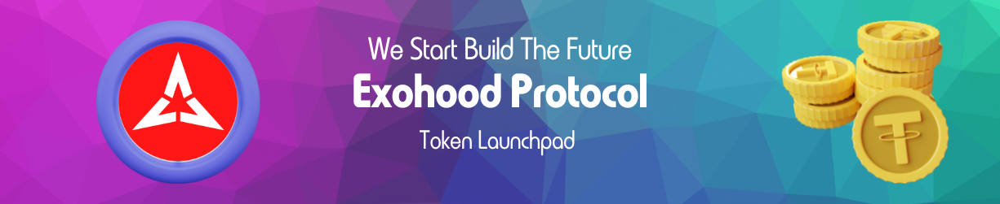

# Exohood Token Launchpad — Discontinued

> ⚠️ **PROJECT PERMANENTLY DISCONTINUED — TOKEN LAUNCHPAD UNAVAILABLE**
>
> Exohood Labs has permanently discontinued the Exohood Token Launchpad project.
>
> **The platform is no longer operational. No token creation, smart contract deployment, token issuance, payment processing, or related services are available under this initiative.**
>
> No relaunch or continuation of the service is planned.

## Project Status

**Status:** Permanently Discontinued  
**Service Availability:** Unavailable  
**Token Deployment:** Disabled  
**Payments:** Not Accepted  
**Technical Support:** Discontinued  
**Future Development:** Not Planned  

## Historical Project Information

Exohood Token Launchpad was originally proposed as a platform for creating and deploying digital tokens across multiple blockchain networks.

The initiative included concepts for automated smart contract deployment, token configuration, supply allocation, and contract verification.

Development references previously included Ethereum, Base, Solana, Arbitrum, Avalanche, Polygon, BNB Chain, Blast, and the proposed Exohood blockchain.

These references are historical and do not represent currently supported networks or active deployment capabilities.

The proposed Exohood blockchain initiative has also been permanently discontinued.

## Payments and Smart Contract Deployment

**Do not send cryptocurrency, stablecoins, or other funds to any wallet address previously associated with the Token Launchpad.**

Exohood Labs no longer accepts payments for token creation, deployment packages, contract verification, or related services through this project.

Previously published payment instructions, wallet addresses, pricing information, deployment procedures, and technical specifications are obsolete.

Payments or transactions sent to historical addresses may be irreversible and may not result in any service being provided.

## Third Party Impersonation Warning

Exohood Labs does not authorize, operate, promote, or endorse third party platforms claiming to be an official continuation of the Exohood Token Launchpad.

Users should not transfer funds, connect wallets, approve smart contracts, or disclose private keys or recovery phrases to services making such claims.

## Repository Notice

This repository is retained exclusively for historical, technical, and archival purposes.

Its contents do not represent an active product, supported deployment service, or future development commitment.

Any available source code remains subject to its applicable license and copyright notices.

The repository may contain outdated dependencies, experimental implementations, or security vulnerabilities.

**Do not use this repository as a production deployment service without an independent technical and security assessment.**

Exohood Labs does not provide ongoing maintenance, updates, deployment assistance, or technical support for this discontinued project.

## Relationship With Current Products

The discontinuation of Token Launchpad does not affect Exoswap, the separate non custodial decentralized exchange application developed by Exohood Labs.

Exoswap does not operate this former token issuance service.

This repository is also unrelated to any new issuance of the existing EXO governance token.

---

**Project Status: Permanently Discontinued.**
